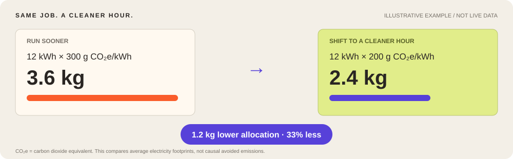
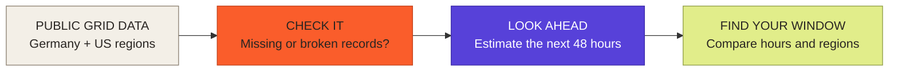
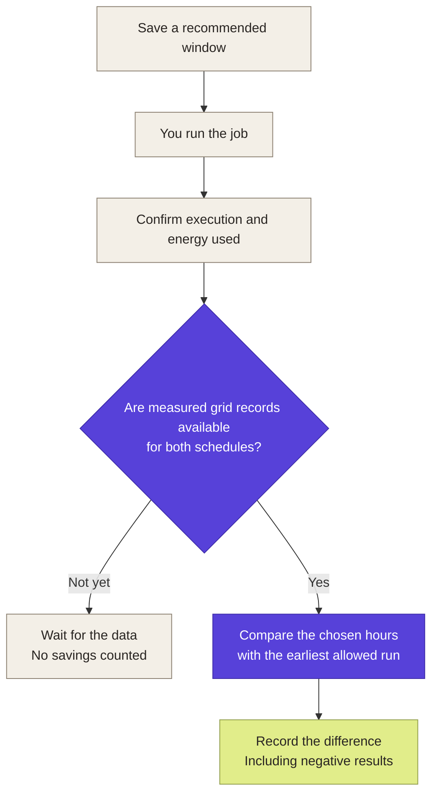
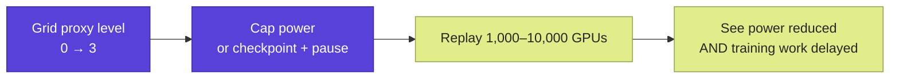

# ϟ GridPulse

### Same job. A cleaner hour.

**GridPulse helps you choose when to use electricity.**

Electricity changes throughout the day. If your work can wait, GridPulse looks for cleaner or cheaper hours.

**[Open the dashboard ↗](https://sohamshindework.github.io/gridpulse/)** · [Try it on your computer](docs/developer-guide.md#run-it)

## 1. The idea in one picture

Backups, AI training and electric-car charging can sometimes wait. Same work. Different electricity footprint.

**kWh** is an amount of electricity. **CO₂e** describes climate impact, including gases other than carbon dioxide.

## 2. Where the answer comes from

Public data shows the electricity mix: coal, gas, wind, solar and more. GridPulse estimates its climate footprint.

**Coverage:** Germany, California, Texas and the US Mid-Atlantic. Published German wholesale prices are included; US prices are unavailable.

## 3. How you use it

| You tell GridPulse… | For example… |
|---|---|
| How much electricity the job needs | 12 kWh |
| How long it takes | 3 hours |
| When it must finish | Tomorrow morning |
| Where it may run | Germany only |
| What matters most | Lower carbon, lower cost, or both |

It recommends a window within your rules. Jobs can run continuously or pause between hours.

**You run the job.** The dashboard does not control your devices.

## 4. An estimate is not a saving

The recommendation is an estimate. The ledger checks the result afterwards.

Your ledger stays in your browser. You confirm execution and energy use; public sources provide grid measurements. **Saving a plan counts as zero savings.**

## 5. Know the limits

| What you see | What it means |
|---|---|
| Measurements | Real public data, sometimes delayed. Check the timestamps. |
| Forecast + shaded range | Estimates based on recent patterns and past errors. No guarantee. |
| Carbon / cost differences | Average footprints and wholesale costs, not proven avoided emissions or your full bill. |

Updates are scheduled hourly. Failed updates keep the last good snapshot. Old data pauses scheduling.

Advanced AI forecasts, imported-electricity accounting and modelling how power plants respond to demand are **future work**.

## 6. GridFlex: what if the job is already running?

**Keep inference running. Let flexible training make room.**

[Try the GridFlex lab ↗](https://sohamshindework.github.io/gridpulse/#gridflex)

Real grid history drives a **simulated fleet**, with explicit power, checkpoint and deadline assumptions. It is not a GPU benchmark or a year-long result.

An opt-in Kubernetes controller can request changes from cooperative training jobs. It waits for a saved checkpoint before pausing and leaves inference untouched. [How it works + the CPU-cluster demo](docs/gridflex.md).

## Developer tools

| Tool | What it does |
|---|---|
| [Python library + command line](docs/developer-guide.md#python-sdk-and-cli) | Ask for a suitable window from your own code. |
| [GitHub Action](docs/developer-guide.md#github-action) | Plan a workflow window, with optional bounded waiting. |
| [AI-agent tools / MCP](docs/developer-guide.md#mcp-server) | Let an assistant read grid data and request a schedule. |
| [Public data files / API](docs/developer-guide.md#static-api) | Build your own tools using the published measurements and forecasts. |

**Go deeper:** [Setup & developer guide](docs/developer-guide.md) · [How the calculations work](docs/methodology.md) · [What comes next](docs/roadmap.md)

---

**Data credits:** Energy-Charts / Fraunhofer ISE · Bundesnetzagentur | SMARD.de · U.S. EIA. [Data terms](docs/data_licences.md) · [MIT software licence](LICENSE)
