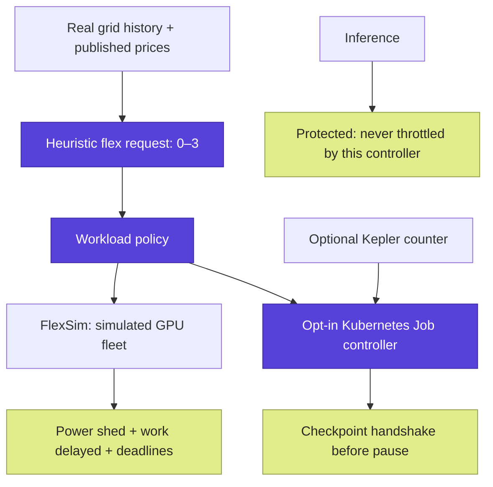

# GridFlex: make room without hiding the trade-off

**GridPulse picks when work starts. GridFlex explores how flexible running work can be.**



## Try it

Open the [GridFlex lab](https://sohamshindework.github.io/gridpulse/#gridflex), choose 1,000–10,000 GPUs, a measured historical period, a region and a policy. Change the protected inference allocation and compare the replays. Download JSON with inputs, configuration and traces.

```sh
# From an installed local checkout; uses the committed real-data snapshot.
gridpulse flex-sim --region DE --gpus 10000 --hours 168 --output replay.json
# Independent power-cap policy, or pause-only at the highest flex level.
gridpulse flex-sim --region US-CAISO --gpus 1000 --hours 72 --mode power-cap
# Inspect proposed Kubernetes patches offline: NO cluster access or mutations.
python -m gridpulse.gridflex.operator --jobs k8s/fixtures/jobs.json --level 3
```

Reports contain `kind: simulation`. No GPU fleet has been measured. A low-energy run with less completed work is **not an equal-work savings result**.

## 1. What the levels mean

| Level | Default training policy | Inference |
|---|---|---|
| 0 | Normal power and parallelism | Protected |
| 1 | Request 85% power | Protected |
| 2 | Request 65% power and 75% parallelism, after checkpoint | Protected |
| 3 | Checkpoint and pause preemptible work; non-preemptible work gets a cap/scale recommendation | Protected |

Other modes: `power-cap` keeps parallelism unchanged and never pauses; `checkpoint` leaves levels 0–2 unchanged and pauses only at level 3. These are explicit experiments, not validated optimal policies.

Migration suggestions require an explicitly allowed alternative region with a lower proxy level. They are **advisory only**. Neither simulator nor controller automatically moves data, provisions capacity or changes residency. A generic Job controller cannot safely infer those constraints or migrate arbitrary distributed training.

## 2. Signals and missing inputs

German proxy: renewable share below 30% → level 1, below 15% → level 2. Published wholesale EUR prices at or above .12/.20/.30 per kWh → levels 1/2/3. Use the maximum applicable level. Low renewables alone do not mean a grid has inadequate reserves.

US proxy: actual hourly EIA demand above its published forecast by 2%/5%/10% → levels 1/2/3. Demand below forecast contributes level 0. Match hour-ending labels after UTC conversion. EIA forecast revisions have no retained issue-time in this adapter, so this is a retrospective demand-deviation proxy, not a rigorously archived operational alert.

If independently supplied available capacity is present, capacity margins below 15%/7%/3% can contribute levels 1/2/3. **No such capacity feed is connected. All published reserve margins are null.** Net generation is not substituted for available capacity.

Future German levels use the renewable baseline and actual published prices. Future US levels repeat the most recent historical same-UTC-hour demand deviation available strictly before the forecast origin, with a 72-hour reference-age limit. These are proxy outlooks, not calibrated stress predictions. Unknown input stays unknown; the simulator rejects unknown hours and gaps.

Source attribution and input values accompany each signal. Public files:

- [`/api/v1/gridflex/signals.json`](https://sohamshindework.github.io/gridpulse/api/v1/gridflex/signals.json)
- [`/api/v1/gridflex/simulations.json`](https://sohamshindework.github.io/gridpulse/api/v1/gridflex/simulations.json)
- The existing `status.json` includes `gridflex.regions` and precomputed 1,000-GPU replay examples.

## 3. FlexSim model card

| Parameter | Default / interpretation |
|---|---|
| Time step | Five minutes; real grid inputs are hourly and piecewise constant |
| Fleet | Configurable 1–10,000 GPUs; UI starts at 1,000 |
| Inference | Fixed 20% of GPUs, 500 W/GPU; identical work in both replays |
| Training GPU power | 700 W active, 100 W idle |
| Host overhead / PUE | 70 W per GPU / 1.2 |
| Synthetic training arrivals | One job every six hours; work = 85% of six hours at full training-fleet throughput |
| Scheduling / deadlines | Earliest deadline first; twelve hours from arrival; no dropped jobs |
| Preemptibility | Deterministic approximately 80% across jobs; no random noise added |
| Cap speed assumptions | 85% power → 95% per-GPU speed; 65% → 80%; 60% → 72% |
| Checkpoint / resume | Five / two minutes; no useful training progress during overhead |
| Tokens | Assumed 1,000 training / 1,500 inference tokens per GPU-second at full useful speed |

The 700 W bound is compatible with an [NVIDIA H100 SXM specification](https://www.nvidia.com/en-us/data-center/h100/), **not a measured workload profile**. Idle, host, PUE, throughput and token-rate values are illustrative modelling assumptions. [Zeus (USENIX NSDI 2023)](https://www.usenix.org/conference/nsdi23/presentation/you) provides background on workload-dependent GPU energy optimisation; no curve or claimed percentage in this implementation is a fitted reproduction of its results.

Facility energy includes GPU idle power, busy power, protected inference, host overhead and PUE. Reducing parallelism idles the unused training GPUs. Checkpoints consume simulated full-power overhead; paused GPUs retain idle power. The uncontrolled replay gets the same synthetic arrivals, deadlines, inference and grid trace. Work not completed by the replay end remains pending and contributes to the reported training-work difference. Jobs whose deadlines fall outside the replay are pending, not counted as missed deadlines yet.

Report together: peak and mean MW shed in request hours, training GPU-hours lost, lost GPU-hours per net MWh difference, deadline misses/observed deadlines, pending jobs, checkpoint overhead, energy, modelled tokens/kWh, and measured-grid average carbon allocation. Negative net energy/carbon/cost differences remain negative. Missing prices make full-period cost differences null. There is no annual extrapolation or claim of causal marginal CO₂ avoidance.

Replaying a complete year requires a complete, auditable yearly dataset. The initial dataset is about two weeks. Realistic hardware conclusions require profiling the exact GPU, model, batch size, interconnect and checkpoint store, and varying parameters in sensitivity studies.

## 4. Kubernetes demo: opt in explicitly

The controller is dry-run by default and limited to one namespace. It patches only `batch/v1` Jobs labelled `gridpulse.dev/flex-enabled: 'true'` and `gridpulse.dev/workload: training` or `batch`. Inference is excluded even if enabled. Owner-suspended and completed Jobs are not resumed or altered.

It records original parallelism/suspend values and restores its restrictions at level 0 or on stale/unknown signals. Checkpoint requests carry a generation token: a later pause requires a new acknowledgement. Reducing parallelism or suspending requires `gridpulse.dev/checkpoint-ready` to match the current token. Multiple ranks require an explicitly labelled checkpoint coordinator that attests all ranks are persisted. Without that coordinator, the controller waits; it does not kill workers to force a checkpoint.

Power fractions and batch/parallelism hints are cooperative requests. Kubernetes does not natively apply GPU watt caps from annotations. A real workload or privileged, exclusively scoped device agent must implement that hook and report actual throughput/energy. The mock workload acknowledges persisted checkpoints on a PVC and simulates progress on CPU; it does not claim to set real GPU power.

```sh
# Requires Docker, kind and kubectl. Creates a disposable local cluster.
kind create cluster --name gridflex
docker build -f k8s/Dockerfile -t gridflex:test .
kind load docker-image gridflex:test --name gridflex
kubectl apply -f k8s/demo.yaml
kubectl -n gridflex-demo rollout status deployment/gridflex
python3 scripts/kind-smoke.py
# When finished with your disposable cluster:
kind delete cluster --name gridflex
```

The demo manifest explicitly uses `--apply` in **gridflex-demo**. It creates a namespaced service account/Role, a controller, a persistent checkpoint volume and training/inference mock Jobs. It does not touch another cluster or namespace. Kubernetes test results are in [GridFlex kind integration](https://github.com/sohamshindework/gridpulse/actions/workflows/gridflex_kind.yml).

The smoke test uses deterministic ConfigMap levels. For published signals, run the controller with:

```sh
python -m gridpulse.gridflex.operator --namespace YOUR_NAMESPACE \
  --signal-url https://sohamshindework.github.io/gridpulse/api/v1/status.json \
  --region DE
# Still dry-run. Add --apply only after integrating and testing your workload hooks.
```

Live mode requires in-cluster credentials. Forecast snapshots older than six hours, measurements older than 24 hours, absent current-hour levels or invalid levels become unknown and release managed restrictions. Transient API conflicts are retried at the next loop. The single-controller demo does not implement leader election; run one replica. Original managed fields belong to this controller while a Job is opted in; do not concurrently scale them with another controller.

## 5. Kepler and hardware adapters

Set `KEPLER_METRICS_URL` to your in-cluster Prometheus-format endpoint. `KEPLER_METRIC` defaults to `kepler_container_joules_total`; configure the actual counter name your Kepler version exposes. Only the configured namespace is summed. Two monotonic energy-counter samples yield power in watts; resets, missing metrics and errors yield **unknown**, not zero. Selected metrics may cover CPU only; the adapter does not imply that GPUs are measured. Telemetry is logged separately and is not used to manufacture controller savings.

An optional explicit single-GPU experiment helper is available:

```sh
# Dry-run: query one specified device and show a bounded cap.
python -m gridpulse.gridflex.gpu_agent --gpu GPU-YOUR-UUID --fraction 0.85
# With exclusive device assignment and nvidia-smi permissions:
python -m gridpulse.gridflex.gpu_agent --gpu GPU-YOUR-UUID --fraction 0.85 \
  --exclusive --apply --seconds 30
```

It clamps to reported device limits and restores the original cap on normal exit, Python exceptions, interrupt or SIGTERM. Process/host failure or SIGKILL cannot guarantee restoration; production needs an independent device watchdog. It is not launched automatically by the Kubernetes controller, and no real GPU experiment is claimed here.

## 6. SDK and AI-agent tools

```python
from gridpulse import flex_signal
signal = flex_signal('DE')  # includes timestamps, inputs, limitations and attribution
```

MCP adds `get_flex_signal(region)` and `simulate_fleet(region, gpus, hours, mode)`. Tools never mutate a cluster. Replay results include configuration, assumptions and trade-offs. Full reproducible traces are available through the CLI and dashboard download.

## Verification and remaining boundaries

Unit/contract tests cover levels, missing capacity, forecast leakage, non-preemptible policy selection, protected inference, deterministic replay, no-stress identity, fleet scaling, missing prices, checkpoint costs, stale restoration, new acknowledgements each pause cycle, idempotent dry-run reconciliation, Kepler resets and GPU bounds without hardware execution. Browser replay fixtures cross-check all three policies against Python.

The kind workflow exercises real Kubernetes Job suspension, persistent checkpoint reload, repeated checkpoint cycles and inference protection on CPU mocks. It does not validate distributed-training checkpoint correctness, a real Kepler deployment or actual GPU power/performance. Upstream Kepler/KEDA/Compute Gardener contributions have not been submitted or claimed.
